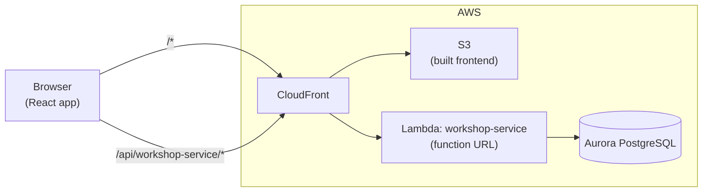

# Architecture

Project Manager, a project tracking system: admins create projects for managers, managers plan milestones and assign their
team, and employees log the time they spend. The system tracks progress, budget against cost, and who changed
what.

This document describes how the code is organised, how a request flows through it, and the rules it enforces —
above all who may do what.

- [System overview](#system-overview)
- [Repository layout](#repository-layout)
- [Backend structure](#backend-structure)
- [Data model](#data-model)
- [Authentication](#authentication)
- [Authorization](#authorization)
- [Business rules](#business-rules)
- [Errors](#errors)
- [Audit log](#audit-log)
- [Configuration](#configuration)
- [Testing](#testing)
- [Adding an endpoint](#adding-an-endpoint)
- [Known limitations](#known-limitations)

## System overview

The backend is a single Java service, `workshop-service`, deployed as one AWS Lambda function. Every API path is
handled by the same function, which routes internally. Data lives in PostgreSQL. The frontend is a React app
with a sign-in screen and admin, manager and employee views, and a developer API tester remains at `#/tester`.



| | Local development | AWS |
|---|---|---|
| Frontend | Vite dev server, port 3000 | Built into S3, served by CloudFront |
| API entry | Dev proxy `bin/proxy-server.js`, port 3001, which strips `/api/workshop-service` and forwards to the LocalStack function URL | CloudFront forwards `/api/workshop-service*` unchanged to the function URL |
| Lambda | LocalStack; runs the jar in `backend/workshop-service/target/lib` and hot-reloads it | AWS Lambda, Java 25, 512 MB |
| Database | PostgreSQL on the host | Aurora PostgreSQL (`infra/rds.tf`), SSL required |
| Deploy | `./bin/deploy-backend.sh local` | `./bin/deploy-backend.sh aws`, then `./bin/deploy-frontend.sh aws` |

Requests arrive with or without the `/api/workshop-service` prefix depending on the path they took; the backend
removes it, so both forms reach the same routes.

## Repository layout

```
backend/
  workshop-service/                 the Lambda; any backend/* folder with a pom.xml becomes a function
    pom.xml                         Java 21 build, shaded jar; Spring, PostgreSQL JDBC, BCrypt, java-jwt, Gson
    src/main/java/com/acme/
      Handler.java                  Lambda entry point
      models/                       domain records and enums: User, Project, Milestone, TimeEntry, AuditEntry,
                                    Role, CompletionStatus, and ProjectView (a project as one role may see it)
      repos/                        database access: *Repository interfaces, their Postgres* implementations,
                                    PostgresDatabase (connection, transactions, schema), StorageException
      services/                     business logic and validation: AuthService, TokenService,
                                    TokenAuthenticator, PasswordHasher, UserService, ProjectService,
                                    ProjectRules, TimeService, AuditService
      controllers/                  HTTP routes and their access rules, one controller per area:
                                    Status, Auth, User, Project, Milestone, Time, Audit
      utils/                        shared helpers: Checks (field validation used by the models)
      http/                         routing plumbing: Router, ApiRequest, ApiResponse, Access, Json
      errors/                       domain exceptions mapped to HTTP statuses
      config/AppConfig.java         Spring wiring and the list of controllers
    src/test/java/com/acme/         API-level tests per role, TestApp harness
      repos/                        in-memory test doubles of every repository, PostgreSQL repository tests
      services/, models/            unit tests
  _examples/                        workshop templates (not deployed)
frontend/
  src/App.jsx                       chooses the screen from the signed-in user and the #/ route
  src/auth/AuthContext.jsx          signed-in user, sign-in/out, password change, token renewal
  src/pages/                        SignIn, ChangePassword (forced change only), Options (tabs: Account,
                                    Appearance, System for admins), Projects and ProjectDetail (every role;
                                    employees get a reduced view), Employees, Workload and AuditLog (admins), Team and Workload
                                    (managers), ApiTester (#/tester); on Employees and Team, an employee's
                                    row opens to show their work (EmployeeWork); on Employees, a manager's
                                    opens to show their projects, milestones and team (ManagerWork)
  src/timer/TimerContext.jsx        the signed-in user's running timer, shared by the timer bar and project view
  src/components/                   NavBar (Options is the gear icon), Loading (spinner), forms (Project,
                                    Milestone, User, ResetPassword), Modal, Field, AuditTable, AssigneeList,
                                    HoursProgress (completion %), StatusAge, StatusBadge, ErrorMessage,
                                    ProjectTeam (who is responsible for a project, in its full view),
                                    ProjectPreview (a project opened in place in
                                    the list), RunningTimer (clock and Stop, on the timer's milestone in the
                                    project view, else in the TimerBar under the nav bar), LogTimeForm,
                                    TimeEntries; PresetList, RequestForm, ResponsePanel and
                                    TimerPanel belong to the tester
  src/services/api.js               API client: session storage, bearer token, refresh-and-retry on 401
  src/utils/                        formatting, project availability, audit descriptions, user search,
                                    form validation (+ Vitest tests next to each file)
infra/                              Terraform: Lambda, CloudFront, S3, Aurora, IAM
bin/                                setup, deploy and dev-environment scripts, dev proxy
docs/                               workshop guides
```

## Backend structure

The code is organised by layer, one package per layer. Each layer only calls the one below it:
controllers call services, services call repositories, and all of them use the models.

| Layer | Package | Knows about | Responsibility |
|---|---|---|---|
| Entry point | `Handler` | the Lambda event | Turns the event into an `ApiRequest`, dispatches it, maps exceptions to responses |
| Routing | `http/` | routes and their `Access` | Matches method and path, enforces authentication and role, fills `{placeholders}` |
| Controllers | `controllers/` | HTTP | Declare routes with their access rule; read the request; call a service; build the response |
| Services | `services/` | business rules | Data scoping per role, validation across records, auditing; know nothing about HTTP |
| Repositories | `repos/` | SQL | Persist records; multi-step writes run in one transaction |
| Models | `models/` | — | Immutable records that validate themselves when constructed, using `utils/Checks` |

### Request lifecycle

1. `Handler.handleRequest` receives the function URL event and builds an `ApiRequest`: method, path segments
   (prefix removed), query parameters, lowercased headers and body (base64-decoded if needed).
2. `Router.dispatch` finds the first route with the same method and a matching pattern, such as
   `/projects/{projectId}/milestones/{milestoneId}`. No match → `404 No route for …`.
3. If the route's `Access` requires sign-in, the router calls `TokenAuthenticator`: it verifies the bearer token
   and loads the user from the database. It then checks the user's role against the route. Failures → 401 or 403.
4. The controller parses the body into a model (`Json` registers adapters for dates, timestamps and statuses) and
   calls the service with the signed-in user.
5. The service applies the per-role data rules and business rules, writes through a repository, and records an audit
   entry.
6. The controller returns an `ApiResponse`; `Handler` turns it into the `{statusCode, headers, body}` map the
   function URL sends back. Any exception on the way becomes an error response (see [Errors](#errors)).

### Start-up and state

On a cold start the no-argument `Handler` constructor builds the Spring context from `AppConfig`. No database
connection is opened until the first query. `PostgresDatabase` keeps one connection per Lambda instance,
reconnects when it goes stale, and on each new connection creates or upgrades the tables. No business data is
kept in memory between requests.

## Data model

| Table | Holds | Notes |
|---|---|---|
| `users` | Accounts | `role` (ADMIN, MANAGER, EMPLOYEE), `manager_id` (employees only), `job_type`, `salary` (annual), BCrypt `password_hash`, `password_change_required`, `archived_at` |
| `projects` | Projects | `manager` (user id), `budget`, `status`, `description`, `start_date`/`end_date`, `depends_on` (project ids), `expected_hours`, `completed_at`, `status_changed_at`, `archived_at` |
| `milestones` | Milestones of a project, in order | `assigned_employees` (user ids), `depends_on` (milestone ids), `status`, `progress_time` (hours), `expected_hours`, `completed_at`, `status_changed_at`, `archived_at` |
| `time_entries` | Logged time and running timers | `source` (MANUAL/TIMER), `hours`, `hourly_rate` and `cost` captured when logged, correction fields; one running timer per user enforced by a unique index |
| `refresh_tokens` | Refresh tokens | SHA-256 hash only, `expires_at`, `revoked_at` |
| `audit_entries` | Audit log | `action`, `actor` (email), `details` (JSONB), `occurred_at` |
| `app_settings` | Shared settings | The JWT signing secret, generated on first use; the bottleneck thresholds admins set |

- **Ids** are random UUIDs, generated by the server unless the client supplies one.
- **Statuses** are `TODO → IN_PROGRESS → AWAITING_REVIEW → COMPLETE`.
- **Server-set fields**: `completedAt` and `statusChangedAt` (set on creation and on every status change; unknown
  for records saved before it existed). Clients cannot set either.
- **Computed fields** are worked out on read rather than stored:
  - a project's `progressTime` is the sum of its active milestones' progress;
  - `spent` is the total cost of the project's time entries;
  - `dependencies` names each project in `dependsOn` with its status, so a manager can tell whether a dependency
    owned by another manager is complete without being able to open it.
- **Nothing is deleted.** Projects, milestones and users get `archived_at`, time entries are corrected rather than
  removed, and refresh tokens are revoked. The milestone foreign key refuses to delete a project that has
  milestones, even from a database console.

## Authentication

- **Premade admin**: on a database with no accounts, the first sign-in creates an ADMIN with the email
  `admin@acme.com` and the password `ChangeMe123!`. `ADMIN_EMAIL` and `ADMIN_PASSWORD` on the Lambda override
  those defaults. It takes a table lock, so two simultaneous sign-ins cannot create two admins. Because the
  credentials are documented, the account is created with `passwordChangeRequired`: until it changes its password,
  the router refuses every route except viewing its own account and changing its password (`403 Change your
  password before continuing`). There is no sign-up; admins create every other account.
- **Sign-in**: `POST /auth/login` with email and password returns
  `{accessToken, refreshToken, tokenType: "Bearer", expiresIn: 900, user}`. Emails are case-insensitive. A wrong
  password, an unknown email and an archived account all return the same `401 Invalid email or password`, and an
  unknown email still costs one BCrypt comparison, so neither the message nor the timing reveals which accounts
  exist.
- **Access token**: an HS256 JWT valid for 15 minutes, sent as `Authorization: Bearer <token>`. Its subject is the
  user id. The signing secret is a random 256-bit value stored in `app_settings` and shared by all Lambda
  instances.
- **Refresh token**: 32 random bytes, valid for 7 days, stored only as a SHA-256 hash, usable once.
  `POST /auth/refresh` returns a new pair and revokes the old token. Presenting an already-used token revokes every
  refresh token of that user, since it suggests theft. `POST /auth/logout` revokes the given token.
- **Passwords**: BCrypt (cost 10), at least 8 characters and at most 72 bytes. Changing your own password
  (`POST /auth/password`) needs the current one; it and an admin reset both revoke all of the user's refresh
  tokens.
- **Immediate effect**: every authenticated request reloads the user from the database, so archiving an account
  or changing its role takes effect at once, not when the token expires.
- **Frontend**: the app keeps the session in `sessionStorage` (a reload stays signed in, closing the tab signs out),
  sends the access token on every request, renews both tokens every 10 minutes, and on a `401` refreshes once and
  retries. If the refresh fails it returns to the sign-in screen.

## Authorization

Authorization happens in two layers, so a missing check in one is caught by the other:

1. **Route level, in the router.** Every route declares an `Access` when it is registered: `PUBLIC`, `SIGNED_IN`
   (any role) or a set of roles. A route cannot be registered without one, and the router checks it before the
   controller runs.
2. **Data level, in the services.** For routes open to several roles, the service decides *which* records the
   user may see or change: a manager only their own projects, an employee only their own milestones, and so on.

### Endpoint permissions

✓ = allowed; *scoped* = allowed for the records described in [Data scoping](#data-scoping); — = 403.

| Method & path | Admin | Manager | Employee | Public |
|---|---|---|---|---|
| `GET /` | ✓ | ✓ | ✓ | ✓ |
| `POST /auth/login`, `/auth/refresh`, `/auth/logout` | | | | ✓ |
| `GET /auth/me` | ✓ | ✓ | ✓ | — (works before a forced password change) |
| `PUT /auth/me` (own name and email) | ✓ | ✓ | ✓ | — |
| `POST /auth/password` (own password) | ✓ | ✓ | ✓ | — (works before a forced password change) |
| `GET /users` | ✓ (`?archived=true` too) | scoped | scoped | — |
| `GET /users/{id}` | ✓ | scoped | scoped | — |
| `POST /users` | ✓ | — | — | — |
| `PUT /users/{id}` | ✓ | — | — | — |
| `DELETE /users/{id}` (archive) | ✓ | — | — | — |
| `POST /users/{id}/restore` | ✓ | — | — | — |
| `PUT /users/{id}/manager` (move employee) | ✓ | — | — | — |
| `PUT /users/{id}/password` (reset) | ✓ | — | — | — |
| `GET /projects` | ✓ (`?archived=true` too) | scoped | scoped | — |
| `GET /projects/{id}` | ✓ | scoped | scoped | — |
| `POST /projects` | ✓ | — | — | — |
| `PUT /projects/{id}` | ✓ | scoped, except manager, description and dependencies | — | — |
| `DELETE /projects/{id}` (archive) | ✓ | — | — | — |
| `POST /projects/{id}/restore` | ✓ | — | — | — |
| `GET /projects/{id}/milestones` (`?archived=true` for archived ones) | ✓, archived projects too | scoped | — | — |
| `POST /projects/{id}/milestones` | ✓ | scoped | — | — |
| `PUT /projects/{id}/milestones/{mid}` | ✓ | scoped | — | — |
| `POST /projects/{id}/milestones/{mid}/assignees` (assign) | ✓ | scoped | — | — |
| `DELETE /projects/{id}/milestones/{mid}/assignees/{employeeId}` (unassign) | ✓ | scoped | — | — |
| `POST /projects/{id}/milestones/{mid}/assignees/{employeeId}/move` | ✓ | scoped | — | — |
| `PUT /projects/{id}/milestones/{mid}/status` | ✓ | scoped | own milestones, `AWAITING_REVIEW` only | — |
| `DELETE /projects/{id}/milestones/{mid}` (archive) | ✓ | scoped | — | — |
| `POST /projects/{id}/milestones/{mid}/time` | ✓ | scoped | own milestones | — |
| `POST /projects/{id}/milestones/{mid}/timer` | ✓ | scoped | own milestones | — |
| `GET /timer`, `POST /timer/stop` | own timer | own timer | own timer | — |
| `GET /projects/{id}/milestones/{mid}/time` | ✓ | scoped | own entries on own milestones | — |
| `PUT /time/{id}` (correct an entry) | ✓ | — | — | — |
| `GET /users/{id}/time` (assignments and hours by project and milestone) | ✓ | own team, own projects | themselves | — |
| `GET /time/daily` (hours by person, milestone and day, for the Workload page) | ✓ | own team, own projects | — | — |
| `GET /audit` | ✓ | — | — | — |
| `GET /audit/page` | ✓ | — | — | — |
| `GET /settings/bottlenecks` | ✓ | ✓ | ✓ | — |
| `PUT /settings/bottlenecks` | ✓ | — | — | — |

A missing or invalid token returns `401`; a signed-in user without permission gets `403 Access denied`.

### Data scoping

| | Manager | Employee |
|---|---|---|
| Projects visible | Active projects they manage | Active, not COMPLETE projects where they are assigned to at least one milestone |
| Milestones visible | All in their projects | All in those projects |
| Users visible | Active employees whose manager they are | Their manager, and active employees sharing that manager (themselves included) |
| Project changes | Everything except `manager`, `description` and `dependsOn`; cannot create, archive or restore | None |
| Milestone changes | Add, edit, archive and set any status in their projects | Status only, to `TODO`, `IN_PROGRESS` or `AWAITING_REVIEW` (never `COMPLETE`), only on milestones assigned to them, never on a COMPLETE one |
| Time | Log their own time and run a timer on any milestone of their projects; see hours logged on them | Log time and run a timer on their own milestones; see their own entries |
| Archived records | Not visible | Not visible |

### Field visibility

Some fields are hidden even where the record is visible, because they would reveal pay:

| Field | Admin | Manager | Employee |
|---|---|---|---|
| User `salary` | ✓ | hidden | hidden (own salary included, outside `/auth/me`) |
| Project `budget`, `spent` | ✓ | ✓ | hidden |
| Time entry `hourlyRate`, `cost` | ✓ | hidden | hidden |
| Password hash | never part of any response | | |

## Business rules

### Teams and assignment
- Each employee has at most one manager. Only admins set or change it (`PUT /users/{id}/manager`).
- Every project has exactly one manager, who must be an active MANAGER. Only admins change it.
- Only employees on the **project manager's team** can be newly assigned to that project's milestones, whoever
  makes the change, admins included. To move someone onto another team's project, an admin first moves them to
  that manager.
- An employee works on **at most one unfinished milestone per project** at a time; they can be on several projects.
  Assigning them to a second unfinished milestone of the same project (by any route, or by reopening a completed
  milestone) returns `409`; moving them is how they switch.
- References are checked **when they change**. An employee who later moves team or is archived stays on the
  milestones they already had.
- Account guards:
  - At least one active admin must always remain, and an admin cannot archive themselves.
  - A manager who still has active employees or active projects cannot be archived or given another role until
    those are reassigned.

### Project and milestone integrity
All of these live in `services/ProjectRules.java`, which every project and milestone write goes through:

- **Completion times**: `completedAt` is set when a project or milestone becomes COMPLETE, kept while it stays
  complete, and cleared if it is reopened. Values sent by clients are ignored.
- **Frozen dates**:
  - While a project stays COMPLETE, its dates and its milestones' dates cannot change.
  - While a milestone stays COMPLETE, its dates cannot change.
  - A change that reopens a project or milestone may move its dates in the same request.
- **Milestone dates inside the project**: checked for new milestones, for changed milestone dates, and for every
  milestone when the project's own dates change.
- **No start in the past**: a project or milestone cannot start before today (UTC). Checked when it is created or its
  start date changes, so work that has already started stays editable.
- **Start after dependencies**: a milestone or project cannot start before the unfinished milestones or projects it
  depends on end (starting the day they end is fine), and a dependency's end cannot move past the start of
  something that depends on it. Completed dependencies no longer constrain anything.
- **Possible expected hours**: expected hours are at most 24 hours a day, for each day from start to end inclusive,
  for each person: a milestone's assignees, or for a project everyone assigned to its milestones; at least one.
  Checked when the expected hours or dates change. The forms check all three rules too, and show the limit.
- **Dependencies** (`dependsOn`):
  - Each entry must be another milestone of the same project; self-dependencies and cycles are rejected.
  - A milestone cannot leave TODO until everything it depends on is COMPLETE.
  - A completed milestone cannot be reopened while a milestone depending on it has started.
  - A milestone that others depend on cannot be archived.
- Rules are checked against what a request changes, so records saved before a rule existed stay readable and
  editable.

### Project dependencies
Checked in `services/ProjectService.java`, since they span projects:

- A project's `dependsOn` lists other **active** projects. Self-dependencies and cycles across projects are rejected.
- Only admins set or change it. A project update that leaves `dependsOn` out keeps the existing dependencies; a
  manager may repeat them unchanged but gets `403` for any change.
- A project cannot leave TODO until every project it depends on is COMPLETE. While it is blocked, none of its
  milestones can start and no time can be logged on it.
- A completed project cannot be reopened while a project depending on it has started, and a project others depend
  on cannot be archived.

### Time and cost
- Every role logs **their own** hours, by hand (more than 0, at most 24 per entry) or with a timer. Nobody logs
  time on someone else's behalf; admins correct entries instead.
- **One milestone at a time**: one running timer per user, enforced by the database, and no manual hours
  while a timer runs.
- **8-hour cap**: a timer covers at most one workday. A timer stopped late logs 8.00 hours. A forgotten timer is
  closed at 8 hours the next time its owner looks at, starts or logs time (audited as `timer_capped`).
- **Where time can be logged**: admins on any milestone, managers on milestones of projects they manage, employees
  only on milestones they are assigned to; in every case only on milestones that are not COMPLETE, whose
  dependencies are all complete, and whose project's dependencies are all complete.
- **Progress**: logged hours are added to the milestone's `progressTime` inside the database, in the same
  transaction as the entry, so concurrent requests cannot lose hours.
- **Workload**: an employee's share of the expected hours of the unfinished (not COMPLETE) milestones they are
  assigned to, on projects that are not complete or archived. A milestone's expected hours are split evenly
  between everyone assigned to it; milestones without expected hours are counted, but add no hours. Computed in
  the frontend (`workloadByEmployee` in `utils/projects.js`) from the project list, and shown on Employees, Team
  and, for employees, their own project list. The Workload page (admins: everyone; managers: their team) charts
  each employee's hours logged on those milestones over time against their workload, from `GET /time/daily`.
- **Overview**: the project list opens with a summary of the projects the viewer can see (`utils/overview.js`,
  `components/Overview.jsx`). Admins and managers get the share of milestones complete with projects by status,
  pain points (overdue milestones and projects, blocked projects past their start, reviews waiting past the
  threshold, unassigned open milestones, projects over expected hours or budget), milestones due in 30 days and the
  largest workloads. Employees get their own progress against their workload, their milestones, and the pain
  points and deadlines among those milestones only.
- **Hours per person**: each project response carries `hoursByMilestone` (milestone id → user id → hours), shown
  beside each person in the project list's expanded milestones. Employees receive only their own hours.
- **Cost**: hours × hourly rate, where hourly rate = annual salary ÷ 2,080 (40 hours × 52 weeks). The rate is
  captured on each entry, so later pay changes do not alter past cost. A user without a salary costs 0.
- **Corrections**: an admin can correct an entry's hours (0 to 24, where 0 voids it) with a required reason. The
  cost is recalculated at the original rate, the milestone's progress moves by the difference, and the previous
  values go to the audit log. Two admins correcting the same entry at once cannot overwrite each other.

## Errors

Every error response has the shape `{"error": "<message>"}`.

| Status | When | Raised as |
|---|---|---|
| 400 | Invalid body, field or reference; malformed JSON; wrong field type | `IllegalArgumentException`, `ApiException(400)` |
| 401 | Missing, invalid or expired token; failed sign-in; inactive account | `UnauthorizedException` |
| 403 | Signed in but not allowed | `ForbiddenException` |
| 404 | Unknown route, or record not found (or archived) | `NotFoundException`, `ApiException(404)` |
| 409 | Conflicts with existing state: duplicate id or email, blocked dependency, frozen dates, running timer | `ConflictException` |
| 500 | Database failure (stack trace goes to CloudWatch) | `StorageException` |

On AWS, CloudFront rewrites every 404 into `index.html` with status 200 (`infra/cloudfront.tf`), API responses
included, so API 404s are not visible as such there. To live with this:

- endpoints that answer "nothing here" as a normal case avoid 404: `GET /timer` answers `204` when no timer runs,
  and `POST /timer/stop` answers `409` when there is nothing to stop;
- the frontend treats an HTML reply to an API call as the 404 it was (`services/api.js`);
- error pages are not cached (`error_caching_min_ttl = 0`), so a "not found" never hides data created since.

## Audit log

Every change is recorded in `audit_entries` with the acting user's email and details such as the ids involved.
Details also store the **names** of the people, projects and milestones involved, as they were at the time
(`actorName`, `projectName`, `milestoneName`, `employeeName`, `fromManagerName`, `toManagerName`, …), so the log
reads by name even after renames or archiving. The frontend never shows ids in the log or in messages; error
messages name what they are about, and a record that cannot be found is described without its id.
Reads and rejected requests are not recorded. Admins read them at `GET /audit`, newest first, with optional
filters: `projectId`, `milestoneId`, `action` (one or more, comma-separated), `from` and `to` (`YYYY-MM-DD`,
inclusive, UTC), `q` (text in the action, actor or details, ignoring case) and `limit` (default 100, at most 500).
`GET /audit/page` takes the same filters plus `offset` and returns `{entries, total, offset, limit}`; the Audit Log
page uses it to show pages of 10, 100, 250 or 500 entries with page controls above and below the list.
Entries are timestamped with the same clock as the rest of the service.

| Area | Actions |
|---|---|
| Accounts | `default_admin_created`, `user_created`, `user_updated`, `user_archived`, `user_restored`, `employee_moved`, `password_reset`, `password_changed`, `profile_updated` |
| Projects | `project_created`, `project_updated`, `project_archived`, `project_restored` |
| Milestones | `milestone_added`, `milestone_updated`, `milestone_status_changed`, `milestone_archived`, `employee_assigned`, `employee_unassigned`, `employee_reassigned` |
| Time | `time_logged`, `timer_started`, `timer_stopped`, `timer_capped`, `time_corrected` |
| Settings | `settings_updated` |

## Configuration

The Lambda reads these environment variables, set by Terraform (`infra/locals.tf`):

| Variable | Use |
|---|---|
| `POSTGRES_HOST`, `POSTGRES_PORT`, `POSTGRES_NAME`, `POSTGRES_USER`, `POSTGRES_PASS` | Database connection |
| `IS_LOCAL` | `true` locally (no SSL); otherwise the connection requires SSL for Aurora |

Each connection attempt times out after 5 seconds and each query after 20. Aurora Serverless pauses after 5 idle
minutes and takes about 15 seconds to resume, so `PostgresDatabase` keeps retrying a connection for up to 22
seconds while the server is unreachable; errors that waiting cannot fix, such as a wrong password, fail at once.
All of this stays inside CloudFront's 30-second origin timeout, so a database problem produces a JSON 500 rather
than a CloudFront 504. Secrets for tokens are not configuration; they are generated and stored in the database.

## Testing

```sh
# Backend: API-level tests run against in-memory test doubles of every repository
cd backend/workshop-service
JAVA_HOME=/usr/lib/jvm/java-21-openjdk-amd64 mvn test

# Also run the PostgreSQL repository tests (each runs in its own schema, dropped afterwards)
POSTGRES_TEST_URL='jdbc:postgresql://localhost:5432/postgres?user=…&password=…' mvn test

# Frontend
cd frontend && npm test
```

| Suite | Covers |
|---|---|
| `HandlerTest` | Project and milestone lifecycle, validation messages, CloudFront prefix, base64 bodies, database failures |
| `AuthTest` | Premade admin and its forced password change, sign-in, token expiry, refresh rotation and reuse detection, sign-out, password change |
| `AdminViewTest` | Audit log filters, archived milestones, names in audit entries |
| `UsersTest` | Account creation and validation, moving employees, archiving and lockout, admin guards |
| `ManagerTest` | Every manager permission, allowed and denied |
| `EmployeeTest` | Employee visibility, profile edits, review status, time logging, timer and cap, corrections, cost |
| `IntegrityTest` | Completion times, frozen dates, date ranges, milestone dependencies |
| `ScheduleRulesTest` | No start in the past, start after dependencies, possible expected hours |
| `ProjectDependencyTest` | Project dependencies: blocking, cycles, the chain staying intact, admin-only changes |
| `PostgresRepositoriesTest` | Every PostgreSQL repository, plus schema upgrades from earlier versions |
| `PostgresDatabaseTest` | Retrying the connection while a paused Aurora database resumes |
| `utils/*.test.js`, `services/*.test.js` | Frontend helpers: availability, search, validation, audit text, timer maths |
| `pages/*.test.jsx` | Frontend screens rendered against a fake backend: sign-in and the forced password change, projects, project view, employees, the manager view, the employee view (logging time, the ticking timer) |

`TestApp` wires the whole service with in-memory repositories and a controllable clock, and calls it through the Lambda
entry point with function-URL-shaped events, so the API tests exercise routing and authorization exactly as
deployed.

## Adding an endpoint

1. Register the route in the matching class in `controllers/` with an explicit `Access`: the roles that may call
   it.
2. Put the logic in the matching class in `services/`, including which records each role may touch, and record
   an audit entry for any change.
3. For new data, add or change the record in `models/`, then extend the repository interface in `repos/`, its
   PostgreSQL implementation and its in-memory test double. Add new tables or columns to
   `PostgresDatabase.SCHEMA` (columns as `ADD COLUMN IF NOT EXISTS`).
4. A new controller is added to the list in `AppConfig.router`.
5. Add API tests for every role, allowed and denied, and a preset in `frontend/src/services/presets.js`.

## Known limitations

- **Sign-in protection**: there is no rate limiting or lockout on repeated sign-in attempts.
- **Signing secret**: the token signing secret is stored in the database, so read access to the database would
  allow forging tokens.
- **Not atomic**: a change and its audit entry are written in separate transactions.
- **CloudFront 404s**: on AWS, CloudFront hides API 404s; the API and frontend work around it (see [Errors](#errors)).
- **Memory**: the Lambda runs with 512 MB; BCrypt makes sign-in CPU-heavy, so raise `memory_size` in
  `infra/lambda.tf` if sign-in is still slow.
- **Not yet built** (from the project notes):
  - planned hours per project;
  - weekly-hour (40 h) allocation checks and over-allocation reports;
  - reports on at-risk projects and resource allocation;
  - first and last name and a generated username on users.
