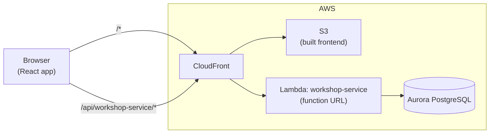

# Architecture

ACME's project tracking system: admins create projects for managers, managers plan milestones and assign their
team, and employees log the time they spend. The system tracks progress, budget against cost, and who changed
what.

This document describes how the code is organised, how a request flows through it, and the rules it enforces —
above all who may do what.

- [System overview](#system-overview)
- [Repository layout](#repository-layout)
- [Backend structure](#backend-structure)
- [Data model](#data-model)
- [Authentication](#authentication)
- [Authorization](#authorization)
- [Business rules](#business-rules)
- [Errors](#errors)
- [Audit log](#audit-log)
- [Configuration](#configuration)
- [Testing](#testing)
- [Adding an endpoint](#adding-an-endpoint)
- [Known limitations](#known-limitations)

## System overview

The backend is a single Java service, `workshop-service`, deployed as one AWS Lambda function. Every API path is
handled by the same function, which routes internally. Data lives in PostgreSQL. The frontend is a React app
(currently an API tester with a live timer panel).



| | Local development | AWS |
|---|---|---|
| Frontend | Vite dev server, port 3000 | Built into S3, served by CloudFront |
| API entry | Dev proxy `bin/proxy-server.js`, port 3001, which strips `/api/workshop-service` and forwards to the LocalStack function URL | CloudFront forwards `/api/workshop-service*` unchanged to the function URL |
| Lambda | LocalStack; runs the jar in `backend/workshop-service/target/lib` and hot-reloads it | AWS Lambda, Java 25, 128 MB |
| Database | PostgreSQL on the host | Aurora PostgreSQL (`infra/rds.tf`), SSL required |
| Deploy | `./bin/deploy-backend.sh local` | `./bin/deploy-backend.sh aws`, then `./bin/deploy-frontend.sh aws` |

Requests arrive with or without the `/api/workshop-service` prefix depending on the path they took; the backend
removes it, so both forms reach the same routes.

## Repository layout

```
backend/
  workshop-service/                 the Lambda; any backend/* folder with a pom.xml becomes a function
    pom.xml                         Java 21 build, shaded jar; Spring, PostgreSQL JDBC, BCrypt, java-jwt, Gson
    src/main/java/com/acme/
      Handler.java                  Lambda entry point
      StatusController.java         GET /
      config/AppConfig.java         Spring wiring and the list of controllers
      http/                         routing, request/response, JSON, access rules
      auth/                         sign-in, tokens, passwords
      users/                        account management
      projects/                     projects, milestones, integrity rules
      timelog/                      time logging and timers
      audit/                        audit log
      errors/                       domain exceptions mapped to HTTP statuses
      models/                       records with built-in validation
      repos/                        store interfaces and PostgreSQL implementations
    src/test/java/com/acme/         API-level tests, test doubles, PostgreSQL tests
  _examples/                        workshop templates (not deployed)
frontend/
  src/pages/ApiTester.jsx           request builder, remembered ids and tokens, token auto-refresh
  src/components/                   PresetList, RequestForm, ResponsePanel, TimerPanel
  src/services/                     apiClient, presets, timer maths (+ Vitest tests)
infra/                              Terraform: Lambda, CloudFront, S3, Aurora, IAM
bin/                                setup, deploy and dev-environment scripts, dev proxy
docs/                               workshop guides
```

## Backend structure

The code is organised by feature, with each feature split into layers:

| Layer | Knows about | Responsibility |
|---|---|---|
| `Handler` | the Lambda event | Turns the event into an `ApiRequest`, dispatches it, maps exceptions to responses |
| `http/Router` | routes and their `Access` | Matches method and path, enforces authentication and role, fills `{placeholders}` |
| Controllers | HTTP | Declare routes with their access rule; read the request; call a service; build the response |
| Services | business rules | Data scoping per role, validation across records, auditing; know nothing about HTTP |
| Stores (`repos/`) | SQL | Persist records; multi-step writes run in one transaction |
| Models (`models/`) | — | Immutable records that validate themselves when constructed |

### Request lifecycle

1. `Handler.handleRequest` receives the function URL event and builds an `ApiRequest`: method, path segments
   (prefix removed), query parameters, lowercased headers and body (base64-decoded if needed).
2. `Router.dispatch` finds the first route with the same method and a matching pattern, such as
   `/projects/{projectId}/milestones/{milestoneId}`. No match → `404 No route for …`.
3. If the route's `Access` requires sign-in, the router calls `TokenAuthenticator`: it verifies the bearer token
   and loads the user from the database. It then checks the user's role against the route. Failures → 401 or 403.
4. The controller parses the body into a model (`Json` registers adapters for dates, timestamps and statuses) and
   calls the service with the signed-in user.
5. The service applies the per-role data rules and business rules, writes through a store, and records an audit
   entry.
6. The controller returns an `ApiResponse`; `Handler` turns it into the `{statusCode, headers, body}` map the
   function URL sends back. Any exception on the way becomes an error response (see [Errors](#errors)).

### Start-up and state

On a cold start the no-argument `Handler` constructor builds the Spring context from `AppConfig`. No database
connection is opened until the first query. `PostgresDatabase` keeps one connection per Lambda instance,
reconnects when it goes stale, and on each new connection creates or upgrades the tables. No business data is
kept in memory between requests.

## Data model

| Table | Holds | Notes |
|---|---|---|
| `users` | Accounts | `role` (ADMIN, MANAGER, EMPLOYEE), `manager_id` (employees only), `job_type`, `salary` (annual), BCrypt `password_hash`, `archived_at` |
| `projects` | Projects | `manager` (user id), `budget`, `status`, `description`, `start_date`/`end_date`, `completed_at`, `archived_at` |
| `milestones` | Milestones of a project, in order | `assigned_employees` (user ids), `depends_on` (milestone ids), `status`, `progress_time` (hours), `completed_at`, `archived_at` |
| `time_entries` | Logged time and running timers | `source` (MANUAL/TIMER), `hours`, `hourly_rate` and `cost` captured when logged, correction fields; one running timer per user enforced by a unique index |
| `refresh_tokens` | Refresh tokens | SHA-256 hash only, `expires_at`, `revoked_at` |
| `audit_entries` | Audit log | `action`, `actor` (email), `details` (JSONB), `occurred_at` |
| `app_settings` | Shared settings | The JWT signing secret, generated on first use |

- **Ids** are random UUIDs, generated by the server unless the client supplies one.
- **Statuses** are `TODO → IN_PROGRESS → AWAITING_REVIEW → COMPLETE`.
- **Computed fields** are worked out on read rather than stored:
  - a project's `progressTime` is the sum of its active milestones' progress;
  - `spent` is the total cost of the project's time entries.
- **Nothing is deleted.** Projects, milestones and users get `archived_at`, time entries are corrected rather than
  removed, and refresh tokens are revoked. The milestone foreign key refuses to delete a project that has
  milestones, even from a database console.

## Authentication

- **First admin**: `POST /auth/setup` creates the first ADMIN and works only while the `users` table is empty; it
  takes a table lock, so two simultaneous calls cannot both succeed. On a fresh deployment, call it immediately.
- **Sign-in**: `POST /auth/login` with email and password returns
  `{accessToken, refreshToken, tokenType: "Bearer", expiresIn: 900, user}`. Emails are case-insensitive. A wrong
  password, an unknown email and an archived account all return the same `401 Invalid email or password`, and an
  unknown email still costs one BCrypt comparison, so neither the message nor the timing reveals which accounts
  exist.
- **Access token**: an HS256 JWT valid for 15 minutes, sent as `Authorization: Bearer <token>`. Its subject is the
  user id. The signing secret is a random 256-bit value stored in `app_settings` and shared by all Lambda
  instances.
- **Refresh token**: 32 random bytes, valid for 7 days, stored only as a SHA-256 hash, usable once.
  `POST /auth/refresh` returns a new pair and revokes the old token. Presenting an already-used token revokes every
  refresh token of that user, since it suggests theft. `POST /auth/logout` revokes the given token.
- **Passwords**: BCrypt (cost 10), at least 8 characters and at most 72 bytes. Changing your own password
  (`POST /auth/password`) needs the current one; it and an admin reset both revoke all of the user's refresh
  tokens.
- **Immediate effect**: every authenticated request reloads the user from the database, so archiving an account
  or changing its role takes effect at once, not when the token expires.
- **Frontend**: the tester sends the access token on every request and renews both tokens every 10 minutes while
  signed in, so a long-running timer stays signed in.

## Authorization

Authorization happens in two layers, so a missing check in one is caught by the other:

1. **Route level, in the router.** Every route declares an `Access` when it is registered: `PUBLIC`, `SIGNED_IN`
   (any role) or a set of roles. A route cannot be registered without one, and the router checks it before the
   controller runs.
2. **Data level, in the services.** For routes open to several roles, the service decides *which* records the
   user may see or change: a manager only their own projects, an employee only their own milestones, and so on.

### Endpoint permissions

✓ = allowed; *scoped* = allowed for the records described in [Data scoping](#data-scoping); — = 403.

| Method & path | Admin | Manager | Employee | Public |
|---|---|---|---|---|
| `GET /` | ✓ | ✓ | ✓ | ✓ |
| `POST /auth/setup` | | | | ✓ while no users exist |
| `POST /auth/login`, `/auth/refresh`, `/auth/logout` | | | | ✓ |
| `GET /auth/me` | ✓ | ✓ | ✓ | — |
| `PUT /auth/me` (own name and email) | ✓ | ✓ | ✓ | — |
| `POST /auth/password` (own password) | ✓ | ✓ | ✓ | — |
| `GET /users` | ✓ (`?archived=true` too) | scoped | scoped | — |
| `GET /users/{id}` | ✓ | scoped | scoped | — |
| `POST /users` | ✓ | — | — | — |
| `PUT /users/{id}` | ✓ | — | — | — |
| `DELETE /users/{id}` (archive) | ✓ | — | — | — |
| `POST /users/{id}/restore` | ✓ | — | — | — |
| `PUT /users/{id}/manager` (move employee) | ✓ | — | — | — |
| `PUT /users/{id}/password` (reset) | ✓ | — | — | — |
| `GET /projects` | ✓ (`?archived=true` too) | scoped | scoped | — |
| `GET /projects/{id}` | ✓ | scoped | scoped | — |
| `POST /projects` | ✓ | — | — | — |
| `PUT /projects/{id}` | ✓ | scoped, except manager and description | — | — |
| `DELETE /projects/{id}` (archive) | ✓ | — | — | — |
| `POST /projects/{id}/restore` | ✓ | — | — | — |
| `POST /projects/{id}/milestones` | ✓ | scoped | — | — |
| `PUT /projects/{id}/milestones/{mid}` | ✓ | scoped | — | — |
| `PUT /projects/{id}/milestones/{mid}/status` | ✓ | scoped | own milestones, `AWAITING_REVIEW` only | — |
| `DELETE /projects/{id}/milestones/{mid}` (archive) | ✓ | scoped | — | — |
| `POST /projects/{id}/milestones/{mid}/time` | — | — | own milestones | — |
| `POST /projects/{id}/milestones/{mid}/timer` | — | — | own milestones | — |
| `GET /timer`, `POST /timer/stop` | — | — | own timer | — |
| `GET /projects/{id}/milestones/{mid}/time` | ✓ | scoped | own entries on own milestones | — |
| `PUT /time/{id}` (correct an entry) | ✓ | — | — | — |
| `GET /audit` | ✓ | — | — | — |

A missing or invalid token returns `401`; a signed-in user without permission gets `403 Access denied`.

### Data scoping

| | Manager | Employee |
|---|---|---|
| Projects visible | Active projects they manage | Active projects where they are assigned to at least one milestone |
| Milestones visible | All in their projects | All in those projects |
| Users visible | Active employees whose manager they are | Their manager, and active employees sharing that manager (themselves included) |
| Project changes | Everything except the `manager` and `description`; cannot create, archive or restore | None |
| Milestone changes | Add, edit, archive and set any status in their projects | Only `AWAITING_REVIEW`, only on milestones assigned to them, never on a COMPLETE one |
| Time | See hours logged on their projects | Log time and run a timer on their own milestones; see their own entries |
| Archived records | Not visible | Not visible |

### Field visibility

Some fields are hidden even where the record is visible, because they would reveal pay:

| Field | Admin | Manager | Employee |
|---|---|---|---|
| User `salary` | ✓ | hidden | hidden (own salary included, outside `/auth/me`) |
| Project `budget`, `spent` | ✓ | ✓ | hidden |
| Time entry `hourlyRate`, `cost` | ✓ | hidden | hidden |
| Password hash | never part of any response | | |

## Business rules

### Teams and assignment
- Each employee has at most one manager. Only admins set or change it (`PUT /users/{id}/manager`).
- Every project has exactly one manager, who must be an active MANAGER. Only admins change it.
- Only employees on the **project manager's team** can be newly assigned to that project's milestones, whoever
  makes the change, admins included. To move someone onto another team's project, an admin first moves them to
  that manager.
- References are checked **when they change**. An employee who later moves team or is archived stays on the
  milestones they already had.
- Account guards:
  - At least one active admin must always remain, and an admin cannot archive themselves.
  - A manager who still has active employees or active projects cannot be archived or given another role until
    those are reassigned.

### Project and milestone integrity
All of these live in `projects/ProjectRules.java`, which every project and milestone write goes through:

- **Completion times**: `completedAt` is set when a project or milestone becomes COMPLETE, kept while it stays
  complete, and cleared if it is reopened. Values sent by clients are ignored.
- **Frozen dates**:
  - While a project stays COMPLETE, its dates and its milestones' dates cannot change.
  - While a milestone stays COMPLETE, its dates cannot change.
  - A change that reopens a project or milestone may move its dates in the same request.
- **Milestone dates inside the project**: checked for new milestones, for changed milestone dates, and for every
  milestone when the project's own dates change.
- **Dependencies** (`dependsOn`):
  - Each entry must be another milestone of the same project; self-dependencies and cycles are rejected.
  - A milestone cannot leave TODO until everything it depends on is COMPLETE.
  - A completed milestone cannot be reopened while a milestone depending on it has started.
  - A milestone that others depend on cannot be archived.
- Rules are checked against what a request changes, so records saved before a rule existed stay readable and
  editable.

### Time and cost
- Employees log hours by hand (more than 0, at most 24 per entry) or with a timer.
- **One milestone at a time**: one running timer per employee, enforced by the database, and no manual hours
  while a timer runs.
- **8-hour cap**: a timer covers at most one workday. A timer stopped late logs 8.00 hours. A forgotten timer is
  closed at 8 hours the next time its owner looks at, starts or logs time (audited as `timer_capped`).
- **Where time can be logged**: only on milestones the employee is assigned to, that are not COMPLETE, and whose
  dependencies are all complete.
- **Progress**: logged hours are added to the milestone's `progressTime` inside the database, in the same
  transaction as the entry, so concurrent requests cannot lose hours.
- **Cost**: hours × hourly rate, where hourly rate = annual salary ÷ 2,080 (40 hours × 52 weeks). The rate is
  captured on each entry, so later pay changes do not alter past cost. An employee without a salary costs 0.
- **Corrections**: an admin can correct an entry's hours (0 to 24, where 0 voids it) with a required reason. The
  cost is recalculated at the original rate, the milestone's progress moves by the difference, and the previous
  values go to the audit log. Two admins correcting the same entry at once cannot overwrite each other.

## Errors

Every error response has the shape `{"error": "<message>"}`.

| Status | When | Raised as |
|---|---|---|
| 400 | Invalid body, field or reference; malformed JSON; wrong field type | `IllegalArgumentException`, `ApiException(400)` |
| 401 | Missing, invalid or expired token; failed sign-in; inactive account | `UnauthorizedException` |
| 403 | Signed in but not allowed | `ForbiddenException` |
| 404 | Unknown route, or record not found (or archived) | `NotFoundException`, `ApiException(404)` |
| 409 | Conflicts with existing state: duplicate id or email, blocked dependency, frozen dates, running timer | `ConflictException` |
| 500 | Database failure (stack trace goes to CloudWatch) | `StorageException` |

On AWS, CloudFront currently rewrites every 404 into `index.html` with status 200 (`infra/cloudfront.tf`), so API
404s are not visible as such there.

## Audit log

Every change is recorded in `audit_entries` with the acting user's email and details such as the ids involved.
Reads and rejected requests are not recorded. Admins read the 100 most recent entries at `GET /audit`.

| Area | Actions |
|---|---|
| Accounts | `first_admin_created`, `user_created`, `user_updated`, `user_archived`, `user_restored`, `employee_moved`, `password_reset`, `password_changed`, `profile_updated` |
| Projects | `project_created`, `project_updated`, `project_archived`, `project_restored` |
| Milestones | `milestone_added`, `milestone_updated`, `milestone_status_changed`, `milestone_archived` |
| Time | `time_logged`, `timer_started`, `timer_stopped`, `timer_capped`, `time_corrected` |

## Configuration

The Lambda reads these environment variables, set by Terraform (`infra/locals.tf`):

| Variable | Use |
|---|---|
| `POSTGRES_HOST`, `POSTGRES_PORT`, `POSTGRES_NAME`, `POSTGRES_USER`, `POSTGRES_PASS` | Database connection |
| `IS_LOCAL` | `true` locally (no SSL); otherwise the connection requires SSL for Aurora |

Connections time out after 5 seconds and queries after 20, well inside CloudFront's 30-second origin timeout, so
a database problem produces a JSON 500 rather than a CloudFront 504. Secrets for tokens are not configuration;
they are generated and stored in the database.

## Testing

```sh
# Backend: API-level tests run against in-memory test doubles of every store
cd backend/workshop-service
JAVA_HOME=/usr/lib/jvm/java-21-openjdk-amd64 mvn test

# Also run the PostgreSQL store tests (each runs in its own schema, dropped afterwards)
POSTGRES_TEST_URL='jdbc:postgresql://localhost:5432/postgres?user=…&password=…' mvn test

# Frontend
cd frontend && npm test
```

| Suite | Covers |
|---|---|
| `HandlerTest` | Project and milestone lifecycle, validation messages, CloudFront prefix, base64 bodies, database failures |
| `AuthTest` | Setup, sign-in, token expiry, refresh rotation and reuse detection, sign-out, password change |
| `UsersTest` | Account creation and validation, moving employees, archiving and lockout, admin guards |
| `ManagerTest` | Every manager permission, allowed and denied |
| `EmployeeTest` | Employee visibility, profile edits, review status, time logging, timer and cap, corrections, cost |
| `IntegrityTest` | Completion times, frozen dates, date ranges, dependencies |
| `PostgresStoresTest` | Every PostgreSQL store, plus schema upgrades from earlier versions |
| `timer.test.js`, `apiClient.test.js` | Timer maths and placeholder filling in the frontend |

`TestApp` wires the whole service with in-memory stores and a controllable clock, and calls it through the Lambda
entry point with function-URL-shaped events, so the API tests exercise routing and authorization exactly as
deployed.

## Adding an endpoint

1. Register the route in the feature's controller with an explicit `Access`: the roles that may call it.
2. Put the logic in the feature's service, including which records each role may touch, and record an audit
   entry for any change.
3. For new data, extend the store interface and both its PostgreSQL implementation and in-memory test double.
   Add new tables or columns to `PostgresDatabase.SCHEMA` (columns as `ADD COLUMN IF NOT EXISTS`).
4. A new feature's controller is added to the list in `AppConfig.router`.
5. Add API tests for every role, allowed and denied, and a preset in `frontend/src/services/presets.js`.

## Known limitations

- **Sign-in protection**: there is no rate limiting or lockout on repeated sign-in attempts.
- **Signing secret**: the token signing secret is stored in the database, so read access to the database would
  allow forging tokens.
- **Not atomic**: a change and its audit entry are written in separate transactions.
- **Frontend**: it is a developer API tester, not an end-user interface.
- **CloudFront 404s**: on AWS, CloudFront hides API 404s (see [Errors](#errors)).
- **Memory**: the Lambda runs with 128 MB, the minimum, and BCrypt makes sign-in CPU-heavy. Raise `memory_size` in
  `infra/lambda.tf` if sign-in is slow.
- **Not yet built** (from the project notes):
  - planned hours per project;
  - weekly-hour (40 h) allocation checks and over-allocation reports;
  - reports on at-risk projects and resource allocation;
  - first and last name and a generated username on users.
